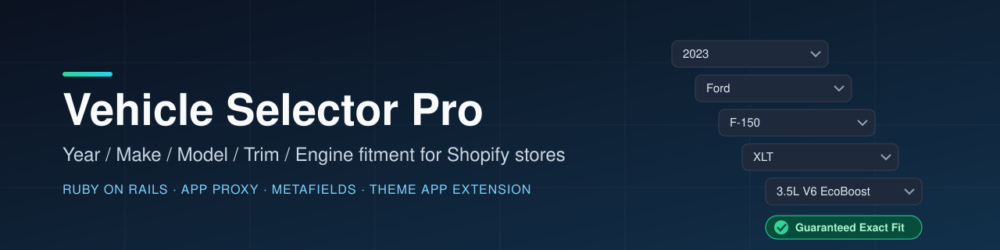
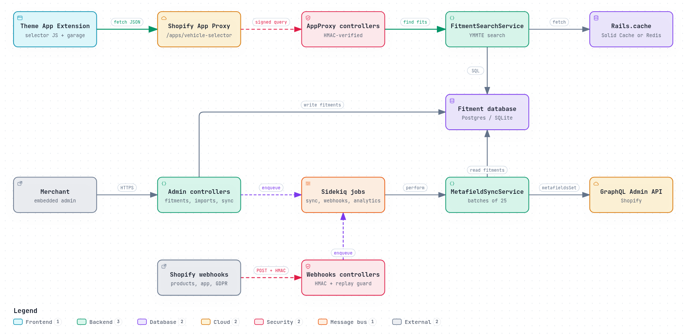

<div align="center">



**Year / Make / Model / Trim / Engine fitment for Shopify stores**

[](https://github.com/muhib-karim/vehicle-selector-pro/actions/workflows/ci.yml)
[](https://github.com/muhib-karim/vehicle-selector-pro/releases)
[](.ruby-version)
[](Gemfile)
[](LICENSE)

[Project report](https://muhib-karim.github.io/vehicle-selector-pro/) · [Demo videos](https://muhib-karim.github.io/vehicle-selector-pro/demo/videos.html) · [Interactive walkthrough](https://muhib-karim.github.io/vehicle-selector-pro/demo/index.html) · [Architecture diagram](https://muhib-karim.github.io/vehicle-selector-pro/architecture.html) · [Changelog](CHANGELOG.md)

</div>

---

## What it is

Vehicle Selector Pro is a multi-tenant **Shopify app** for automotive parts stores, built with **Ruby on Rails 7.2**. Merchants attach Year / Make / Model / Trim / Engine (YMMTE) fitment data to products. Shoppers pick their vehicle from cascading dropdowns on the storefront and see a **"Guaranteed Exact Fit" / "Does NOT Fit" / "Universal Fit"** badge on every product page.

The app has three parts:

- a **Rails backend** (admin UI, App Proxy API, webhooks, background jobs),
- a **Shopify Theme App Extension** (Liquid blocks + vanilla JS) that renders the widget and badges in the merchant's theme,
- a **public demo harness** (`/demo`, `/demo/admin`) that renders the storefront and admin with seeded demo data and no Shopify install.

## Key features

- **Cascading YMMTE selector.** Year → Make → Model → Trim → Engine dropdowns served by HMAC-verified App Proxy endpoints (`app/controllers/app_proxy/`).
- **Product fitment badges.** Exact fit / no fit / universal fit on product pages (`extensions/.../blocks/product_fitment_badge.liquid`).
- **My Garage.** Shoppers save several vehicles in `localStorage` and switch between them across pages.
- **OE part-number search.** Look up parts by factory OE number (`OeNumber` model, admin CSV import).
- **Merchant admin.** Dashboard, vehicle library, product-fitment matrix, bulk CSV import, widget settings, sync monitor.
- **Metafield sync.** Fitment JSON is written to `custom.vehicle_fitment` with the GraphQL `metafieldsSet` mutation in batches of 25 (`Shopify::MetafieldSyncService`), handling throttling and retries.
- **Webhook pipeline.** 8 webhook endpoints (`products/create|update|delete`, `app/uninstalled`, `shop/update`, 3 GDPR topics), processed asynchronously with Sidekiq and replay protection (`WebhookDelivery`).
- **Plans & billing.** 3 tiers (Free / Pro / Pro Plus) through the Shopify Billing API with trial periods, and plan limits on bulk imports (`BillingPlan`, `Shopify::BillingService`).
- **Storefront analytics.** Daily fitment checks, fit rate, and checks-by-make over 7/30/90-day ranges, built from async daily aggregates.
- **Ops.** `/up` and `/health/deep` health checks, structured JSON logging, Sentry, CSP and security headers, Rack::Attack throttling, encrypted shop tokens.

<a id="demo"></a>

## Showcase

Two narrated walkthroughs, one per audience. Click a poster to open the video gallery.

<table>
<tr>
<td width="50%"><a href="https://muhib-karim.github.io/vehicle-selector-pro/demo/videos.html"></a><br><b>Shopper journey</b>: pick a vehicle, browse parts, save it to My Garage.</td>
<td width="50%"><a href="https://muhib-karim.github.io/vehicle-selector-pro/demo/videos.html"></a><br><b>Merchant admin</b>: fitment matrix, bulk CSV import, sync monitor, billing.</td>
</tr>
</table>

The screenshots below are captures of the app's `/demo` and `/demo/admin` routes running against the seed data. They are committed under [`demo/autoplay/frames_live/`](demo/autoplay/frames_live).

<div align="center">

**Storefront: cascading selector**


**Vehicle-filtered results with fitment badges**


**Merchant admin: product fitment matrix**


</div>

More screenshots (PDP, garage, dashboard, vehicles, settings, imports, sync, analytics, billing, OE numbers) are in [`demo/autoplay/frames_live/`](demo/autoplay/frames_live).

Narrated walkthrough videos and the project report are published on GitHub Pages by [`pages.yml`](.github/workflows/pages.yml): [video gallery](https://muhib-karim.github.io/vehicle-selector-pro/demo/videos.html) · [interactive walkthrough](https://muhib-karim.github.io/vehicle-selector-pro/demo/index.html) · [project report](https://muhib-karim.github.io/vehicle-selector-pro/).

> **Hosted demo status.** [`deploy.yml`](.github/workflows/deploy.yml) targets a Fly.io app at `vehicle-selector-pro.fly.dev`. When this README was last updated, that hostname did not resolve, so don't treat it as live. To see the demo, run it locally (below).

## Quick start

Requirements: Ruby 3.4.11 (pinned in [`.ruby-version`](.ruby-version), which `rbenv` reads as-is; `asdf`, `mise` and `chruby` can be configured to), Bundler 2.6, and SQLite for development. Redis is needed only if you run Sidekiq jobs.

```bash
git clone https://github.com/muhib-karim/vehicle-selector-pro.git
cd vehicle-selector-pro
bundle install
cp .env.example .env          # set SHOPIFY_API_KEY, SHOPIFY_API_SECRET, SHOPIFY_STORE_DOMAIN, HOST
bundle exec rails db:prepare
bundle exec rails db:seed     # loads the demo catalog
bundle exec rails server
```

Then open:

| URL | What you get |
|---|---|
| `http://localhost:3000/demo` | Public storefront preview (selector, collection, PDP, garage) |
| `http://localhost:3000/demo/admin` | Read-only merchant admin preview |
| `http://localhost:3000/up` | Liveness check |

To install on a real store, see the [setup guide](docs/SETUP.md) and [merchant installation](docs/MERCHANT_INSTALL.md). This is a custom (unlisted) app, so it installs through a Shopify Partners distribution link.

## Usage

App Proxy API (called by the theme extension through `/apps/vehicle-selector/*`, HMAC-signed by Shopify):

| Endpoint | Purpose |
|---|---|
| `GET years`, `makes`, `models`, `trims`, `engines` | Cascading dropdown values |
| `GET search` | Products matching a selected vehicle |
| `GET check_fitment` | Fit / no-fit / universal for one product + vehicle |
| `GET product_fitments`, `GET garage` | Fitment list for a product; garage data |

Full reference: [docs/API.md](docs/API.md).

## Architecture

<a href="https://muhib-karim.github.io/vehicle-selector-pro/architecture.html"></a>

Every box in the diagram cites the source lines it came from: open the [interactive version](https://muhib-karim.github.io/vehicle-selector-pro/architecture.html) and select a node to see them. It is generated with Archify from [`docs/architecture.archify.json`](docs/architecture.archify.json).

- **Storefront path:** the theme extension calls `/apps/vehicle-selector/*`. Shopify signs the query, `AppProxy::BaseController` rejects anything whose HMAC does not verify, and `FitmentSearchService` answers from `Rails.cache` (Solid Cache, or Redis when `REDIS_URL` is set) or SQL.
- **Merchant path:** admin controllers write fitments, then enqueue Sidekiq jobs. `MetafieldSyncService` pushes `custom.vehicle_fitment` through `metafieldsSet` in batches of 25.
- **Webhooks:** HMAC-verified, de-duplicated by `WebhookDelivery`, processed asynchronously.

Deeper diagrams, the data model, and request lifecycles are in [docs/ARCHITECTURE.md](docs/ARCHITECTURE.md).

| Layer | Technology |
|---|---|
| Framework | Ruby on Rails 7.2 (Puma) |
| Database | PostgreSQL (production) / SQLite (development, test) |
| Background jobs | Sidekiq + Redis |
| Shopify | `shopify_app`, `shopify_api`, Theme App Extension (Liquid + JS), App Proxy, GraphQL Admin API |
| Security | HMAC-SHA256 verification, Rack::Attack, ActiveRecord Encryption, CSP headers |
| Deployment | Dockerfile + `fly.toml` (Fly.io) |

## Testing

The suite has 119 RSpec examples in 23 spec files (models, services, jobs, requests, config) plus 13 Minitest App Proxy integration tests. `spec/config/toolchain_consistency_spec.rb` fails if the Gemfile, lockfile, Dockerfile or CI drift from `.ruby-version`.

```bash
bundle exec rails db:prepare RAILS_ENV=test
ruby spec/test_runner.rb          # RSpec + App Proxy integration; writes coverage/ (SimpleCov)
bundle exec rails zeitwerk:check  # eager-load check
bundle exec rubocop               # lint
bundle audit check --update       # dependency advisories (gem install bundler-audit)
brakeman                          # static security scan (gem install brakeman)
```

Checks that need no Ruby:

```bash
python3 scripts/check_links.py    # README/docs links; fails on missing local files/anchors
node --check extensions/vehicle-selector-pro-extension/assets/vehicle-selector.js
gitleaks git .                    # secret scan over full history
```

CI ([`ci.yml`](.github/workflows/ci.yml)) runs on pushes to `main`, `upgrade/**` and `release/**`, on every pull request, and on demand:

| Job | What it checks |
|---|---|
| Tests (unit + integration) | Full suite on Ruby 3.4.11 and zeitwerk; uploads the `coverage-report` artifact (line + branch) |
| RuboCop | Lint, Ruby 3.4 target |
| Dependency audit | bundler-audit and Brakeman; accepted risks are listed with reasons in [`.bundler-audit.yml`](.bundler-audit.yml) and [`config/brakeman.ignore`](config/brakeman.ignore) |
| Secret scan | gitleaks over full history; pinned historical false positives in [`.gitleaksignore`](.gitleaksignore) |
| Docs + storefront JS | Link check, banner SVG, theme-extension JS syntax |

Tests use dummy Shopify credentials, so no secrets are needed. Dependabot ([`dependabot.yml`](.github/dependabot.yml)) opens weekly grouped updates for gems and GitHub Actions, and resolves gems against `.ruby-version`.

## Project structure

```
app/
  controllers/   admin/, app_proxy/, webhooks/, demo + health controllers
  models/        Shop, Vehicle, VehicleProductFitment, OeNumber, FitmentAnalytic, ...
  services/      fitment search, hierarchy, bulk importer, Shopify GraphQL/billing/metafield sync
  jobs/          metafield sync, webhook processing, analytics rollups
extensions/vehicle-selector-pro-extension/   Shopify Theme App Extension (Liquid + JS + CSS)
config/          Rails config, routes, initializers
db/              schema, migrations, seeds (demo catalog), sample CSVs
spec/            RSpec suites + App Proxy integration test + test_runner.rb
docs/            setup, deployment, operations, API, architecture, privacy
demo/, report/   screenshots, walkthrough videos, project report (published via Pages)
scripts/         link checker, report/demo generation helpers
```

See [PROJECT-STRUCTURE.md](PROJECT-STRUCTURE.md) for the full tree.

## Roadmap and limitations

- **Billing in production.** The Billing API flow is implemented and tested in test mode. Going live means setting `SHOPIFY_BILLING_TEST=false` on a production Partner app and passing App Store review.
- **Not listed on the Shopify App Store.** It installs as a custom app.
- **Planned:** supersession chains on top of the OE-number cross-reference, per-model/per-product analytics rollups, and white-label theming with translations.

- **Rails 8 upgrade.** Rails 7.2 left security support on 2026-08-09. No advisories are open against 7.2.3.2, but the Rails 8 upgrade is the next tracked dependency change (see [TASKS.md](TASKS.md)).

Release history: [CHANGELOG.md](CHANGELOG.md). Handoff notes for the v1.0.0 release: [HANDOFF.md](HANDOFF.md).

## Documentation

[Setup](docs/SETUP.md) · [Merchant install](docs/MERCHANT_INSTALL.md) · [Deployment](docs/DEPLOYMENT.md) · [Operations](docs/OPERATIONS.md) · [API](docs/API.md) · [Architecture](docs/ARCHITECTURE.md) · [Privacy](docs/PRIVACY.md) · [App Store submission](docs/APP_STORE_SUBMISSION.md) · [Requirements verification](REQUIREMENTS-VERIFICATION.md)

## Support

[Open an issue](https://github.com/muhib-karim/vehicle-selector-pro/issues) · [Buy me a coffee on Ko-fi](https://ko-fi.com/ai_dev_2024)

## License

[MIT](LICENSE)
