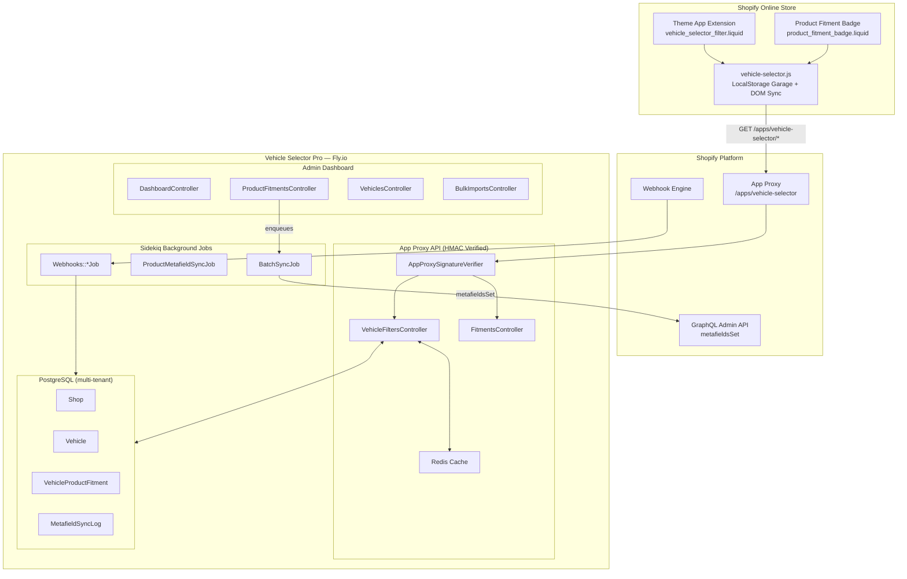

# Vehicle Selector Pro

A Rails implementation of cascading Year / Make / Model / Trim / Engine selection for Shopify automotive stores, with a merchant admin interface and storefront integration code.

[Setup guide](docs/SETUP.md) · [Merchant installation](docs/MERCHANT_INSTALL.md) · [Architecture](#architecture)

## Demo status

The Fly-hosted public demo could not be reached during the 11 October 2026 check (ERR_TUNNEL_CONNECTION_FAILED). This identifies an access failure, not its server-side cause. The previously linked Pages video/gallery URLs also returned 404. They are not advertised as working demos or a video fallback.

Run the seeded demo locally using the setup guide. These are read-only presentation fixtures, not proof of a live Shopify installation. Screenshots below are historical examples. Catalog totals, fitment accuracy and live-store behavior have not been reverified by this audit.

## Verification scope

Review the current CI output and reproduce the documented tests before relying on a release. A green check does not establish Shopify OAuth, billing, webhooks or storefront behavior in your store. Billing features and an installation flow need a real configured test store and should be tested with appropriate development-store safeguards, not accidental production charges.

## Implementation areas

These areas are described by the existing project documentation. This link-containment pass has not independently runtime-tested each one.

- **Cascading storefront widget** — Year, Make, Model, Trim, Engine dropdowns driven by HMAC-signed App Proxy queries
- **Product fitment badges** — Guaranteed Exact Fit / Does NOT Fit / Universal Fit on any product page
- **My Garage** — shoppers save multiple vehicles and switch between them across pages
- **OE part-number search** — shoppers find parts by the factory OE number printed on the part they own
- **Merchant admin** — fitment matrix, vehicle library, bulk CSV import, sync monitor, widget settings
- **Storefront analytics** — daily checks, fit rate, and checks-by-make dashboard (7/30/90-day range) reading async daily aggregates
- **Plans & billing** — Free / Pro / Pro Plus tiers via the Shopify Billing API with 14-day trials; plan ceiling gates bulk imports
- **Metafield sync** — fitment JSON synced to `custom.vehicle_fitment` via `metafieldsSet` in batches of 25 (debounced, resilient)
- **Webhook pipeline** — `products/*`, `app/uninstalled`, `shop/update` processed asynchronously via Sidekiq, replay-protected
- **Operations features** — Solid Cache, ETag caching, structured JSON logging, Sentry, CSP headers, deep health checks, ops runbook
- **Multi-tenant** — per-shop data isolation, encrypted tokens, HMAC-SHA256 verification on every request

---

## Screenshots

### Historical storefront captures

<div align="center">

**Home — cascading Year / Make / Model / Trim / Engine selector with seeded fitment data and shop-by-category**


**Vehicle-filtered results — 2023 Ford F-150 with Guaranteed Exact Fit badges**


**Product detail — spec sheet, verified-fitment chips, and live fitment badge**


**My Garage — vehicles saved across pages in localStorage**


</div>

### Historical merchant preview captures

<div align="center">

**Dashboard — catalog coverage, mapped products, and live sync status**


**Vehicle library — the YMMTE database with cascading filters**


**Product fitment matrix — every product-to-vehicle mapping with sync status**


**Widget & Garage configuration**


**Bulk CSV import**


**Metafield sync monitor**


**Storefront analytics — daily checks, fit rate, and checks-by-make**


**Plans & billing — Free / Pro / Pro Plus tiers with 14-day trials**


**OE part numbers — per-product factory part-number cross-reference**


</div>

The screenshots are historical captures of the seeded presentation pages. They do not establish current deployment availability, catalog totals or live-store behavior.

---

## Architecture



Full system diagrams, data model, and request lifecycles: **[docs/ARCHITECTURE.md](docs/ARCHITECTURE.md)**

---

## Quick start

### Local development

```bash
git clone https://github.com/muhib-karim/vehicle-selector-pro.git
cd vehicle-selector-pro
bundle install
cp .env.example .env    # fill in SHOPIFY_API_KEY / SHOPIFY_API_SECRET / SHOPIFY_STORE_DOMAIN
bundle exec rails db:prepare
bundle exec rails db:seed
bundle exec rails server
```

Then open `http://localhost:3000/demo` for the public storefront preview, or `http://localhost:3000/demo/admin` for the read-only admin preview. The legacy `/storefront_preview` route is also available in development.

---

## Tech stack

| Layer | Technology |
|---|---|
| Framework | Ruby on Rails 7.2 |
| Database | PostgreSQL (production) / SQLite (dev) |
| Background jobs | Sidekiq + Redis |
| Shopify integration | Theme App Extension (OS 2.0), App Proxy, GraphQL Admin API (`metafieldsSet`) |
| Security | HMAC-SHA256 verification, Rack::Attack throttling, ActiveRecord Encryption |
| Hosting | Fly.io (Puma + Sidekiq + Postgres + private Redis) |

---

## Roadmap

**Shipped recently** — full history in [CHANGELOG.md](CHANGELOG.md):

- **v1.3.3 — Catalog wave 5** — Historical catalog expansion for Towing, Electrical, Wipers and Lighting. Current totals and photography provenance not reverified.
- **v1.3.2 — Catalog wave 4 + demo experience** — 20 new products (54 total, 318 fitments) with real photography, a demo billing walkthrough with simulated plan switching, and smoother merchant UI motion
- **v1.3.1 — Rails 7.1.6 → 7.2.3.2 security upgrade** — resolves GHSA-v55j-83pf-r9cq, GHSA-89vf-4333-qx8v and GHSA-2j26-frm8-cmj9 (now removed from the audit whitelist). Plan retained for reference: [docs/RAILS_7_2_UPGRADE_PLAN.md](docs/RAILS_7_2_UPGRADE_PLAN.md)
- **v1.3.0 — Storefront analytics** — daily checks, fit rate, and checks-by-make dashboard with 7/30/90-day ranges
- **v1.2.0 — Shopify Billing** — Free / Pro / Pro Plus tiers with 14-day trials, plan-gated bulk imports
- **v1.1.0 — Production hardening** — Solid Cache, webhook dedup, sync resilience, OE-number cross-reference, fitment confidence scoring, security headers, Sentry

**Planned:**

- **Full billing rollout** — the Shopify Billing API flow (Free / Pro / Pro Plus tiers, 14-day trials, plan-gated imports) is implemented and tested; what remains is flipping `SHOPIFY_BILLING_TEST=false` on a production Partner app and App Store listing approval
- **Supersession chains** — a richer part-catalog engine on top of the shipped OE-number cross-reference
- **Deeper analytics** — per make+model and per-product rollups, conversion lift and drop-off reports on top of the shipped daily aggregates
- **White-label theming** — storefront theming, translation support, deeper widget controls

---

## Documentation

| | |
|---|---|
| [Setup guide](docs/SETUP.md) | Local development environment and public demo routes |
| [Merchant installation](docs/MERCHANT_INSTALL.md) | Safe client handoff, OAuth install and theme setup |
| [Deployment](docs/DEPLOYMENT.md) | Fly.io runbook with provisioning commands |
| [Operations runbook](docs/OPERATIONS.md) | Health checks, backups/restore, monitoring, incidents |
| [API reference](docs/API.md) | App Proxy endpoints, admin endpoints, billing plans, webhook topics |
| [Architecture](docs/ARCHITECTURE.md) | System diagrams and data model (incl. billing, analytics, OE) |
| [Requirements verification](REQUIREMENTS-VERIFICATION.md) | Spec-to-evidence mapping incl. post-spec features |
| [Rails 7.2 upgrade plan](docs/RAILS_7_2_UPGRADE_PLAN.md) | Resolves remaining dependency-audit advisories |
| [Project structure](PROJECT-STRUCTURE.md) | Directory tree and module map |
| [Privacy policy](docs/PRIVACY.md) | GDPR coverage, data inventory, retention (also served at /privacy) |
| [App Store submission](docs/APP_STORE_SUBMISSION.md) | Partners Dashboard steps, listing copy, review notes |
| [Demo script](docs/DEMO_SCRIPT.md) | Voiceover narration for the walkthrough video |
| [Changelog](CHANGELOG.md) | Release history |

---

## Support

If the demo or the project saved you time or inspired an idea, you can **buy me a coffee** — it fuels more free, open development like this.

<div align="center">

[](https://ko-fi.com/ai_dev_2024)

[**Support the project on Ko-fi →**](https://ko-fi.com/ai_dev_2024) · [**Open a support issue →**](https://github.com/muhib-karim/vehicle-selector-pro/issues/new?labels=support&template=blank_issue)

</div>

---

## License & contribution

This project is released under the [MIT License](LICENSE) © 2026 Vehicle Selector Pro contributors.

<div align="center">

[](LICENSE)

[**Read the license →**](LICENSE) · [**Report an issue →**](https://github.com/muhib-karim/vehicle-selector-pro/issues/new?labels=bug&template=bug_report.md) · [**Request a feature →**](https://github.com/muhib-karim/vehicle-selector-pro/issues/new?labels=enhancement&template=feature_request.md)

</div>
